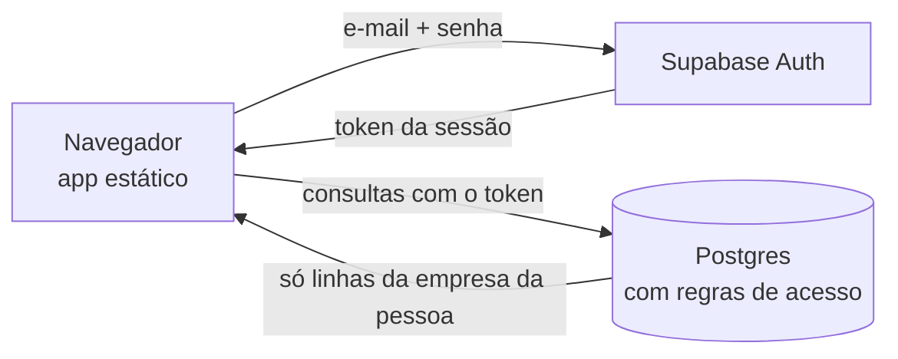

# Esquema de login do Rancho Pedidos

Login por e-mail e senha, banco de dados na nuvem e várias empresas no mesmo
sistema, cada uma enxergando só os próprios dados. Tudo roda no Supabase
(login + Postgres); o app continua sendo HTML, CSS e JS puros em hospedagem
estática.

## Visão geral



1. A pessoa entra com e-mail e senha. O Supabase Auth guarda a senha (com hash)
   e devolve um token de sessão.
2. O app manda esse token em toda consulta. O banco descobre quem é a pessoa,
   qual a empresa dela e qual o papel, e só devolve ou aceita o que as regras
   permitem.
3. A proteção está no banco, não no app. Esconder um botão é só conforto: se
   alguém alterar o código no navegador, o banco continua recusando.

## Empresas e papéis

| | Administrador | Operador |
|---|---|---|
| Ver pedidos, cadastros e relatório | sim | sim |
| Montar, salvar, copiar e apagar pedidos | sim | sim |
| Alterar cadastros (alojamentos, frentes, empresas) | sim | não |
| Importar mensagem do WhatsApp e restaurar backup | sim | não |
| Convidar e remover pessoas | sim | não |

Cada pessoa pertence a uma única empresa. Quem cria uma conta nova e não foi
convidado ganha uma empresa nova e vira administrador dela.

## Fluxos

**Primeira empresa**
1. Criar conta, informando o nome da empresa, o e-mail e uma senha (mínimo 8 caracteres).
2. Abrir o e-mail e clicar no link de confirmação.
3. Entrar. O banco já criou a empresa, o vínculo de administrador e o espaço de cadastros.
4. Em Cadastros, colar uma mensagem antiga do WhatsApp para montar tudo de uma vez.

**Convidar alguém da equipe**
1. Administrador: Cadastros, seção Equipe, informar o e-mail e o papel, Convidar.
2. A pessoa abre o app, escolhe Criar conta, usa exatamente esse e-mail e deixa o
   nome da empresa em branco. Confirma o e-mail e entra.
3. No primeiro acesso o app chama `entrar()`, que coloca a pessoa na empresa que a
   convidou, com o papel escolhido. O convite some.
4. O convite só vale depois que o e-mail da pessoa foi confirmado. Ninguém entra numa
   empresa só por digitar um e-mail alheio.

**Esqueci a senha**
1. Na tela de entrada, Esqueci a senha, informar o e-mail.
2. O Supabase envia um link. Ao abrir, o app mostra a tela Nova senha.
3. A resposta é a mesma exista ou não conta com aquele e-mail, para não revelar quem é cliente.

**Remover alguém**
Administrador: Equipe, Remover. A pessoa perde o acesso na hora e vê o aviso
"Conta sem empresa". A conta dela no sistema de login continua existindo.

## O que o banco garante

Verificado com o arquivo `supabase/test_rls.sql` (27 verificações, todas passando
num Postgres 16 com o login simulado):

- cada cadastro novo cria sua própria empresa e seu administrador;
- uma empresa não lê pedidos, cadastros, equipe nem convites de outra;
- uma empresa não consegue gravar nem criar convite em outra, mesmo conhecendo o id dela;
- sem login não há acesso a nada;
- operador lê e grava pedidos, mas não altera cadastros, não vê nem cria convites e não remove ninguém;
- administrador altera cadastros, convida e remove, mas não remove a si mesmo;
- convite com e-mail não confirmado não dá acesso; depois de confirmado, entra com o papel convidado;
- e-mails são comparados sem diferença de maiúsculas;
- ninguém se coloca sozinho em outra empresa;
- quem foi removido deixa de ler os dados.

## Colocar online, passo a passo

1. **Projeto.** Em supabase.com, crie um projeto (escolha a região South America, São Paulo).
2. **Banco.** No SQL Editor, cole o conteúdo de `supabase/schema.sql` e execute uma vez.
3. **Login por e-mail.** Em Authentication, deixe o provedor Email ligado, com **Confirm email ligado**
   e tamanho mínimo de senha 8. Não desligue a confirmação: é ela que protege os convites.
4. **Endereços.** Em Authentication, URL Configuration: coloque o endereço final do app em Site URL
   e também em Redirect URLs (inclua `http://localhost:8080/` se for testar no seu computador).
   Sem isso os links de confirmação e de nova senha não voltam para o app.
5. **E-mails.** Em Authentication, Emails: traduza os modelos (confirmação, nova senha). Para uso real,
   configure um SMTP próprio (Resend, SendGrid, Amazon SES ou outro). O envio padrão do Supabase tem limite
   baixo de mensagens por hora e serve só para testar.
6. **Chaves.** Em Project Settings, API: copie *Project URL* e a chave *anon public* para `js/config.js`.
   A chave anon é pública por desenho. **Nunca** coloque a `service_role` em nenhum arquivo do app.
7. **Hospedagem.** Publique a pasta inteira em qualquer hospedagem estática com HTTPS
   (Netlify, Cloudflare Pages, Vercel, GitHub Pages ou servidor próprio). HTTPS é necessário para
   instalar como app e para o modo offline.
8. **Teste de ponta a ponta.** Crie uma conta, confirme o e-mail, entre, importe uma mensagem,
   monte um pedido. Depois convide um segundo e-mail como operador, crie a conta dele e confira
   que ele vê os pedidos mas não consegue editar os cadastros. Por fim, crie uma segunda empresa
   com um terceiro e-mail e confira que ela começa vazia.

Rodar o teste das regras de acesso, na pasta do projeto, em um Postgres local descartável
(nunca no banco de produção: o teste cria papéis e tabelas de simulação):

```
createdb teste
psql -d teste -f supabase/test_rls.sql
```

O arquivo simula as partes do Supabase de que o esquema depende. As linhas terminadas em PASSA
estão corretas; qualquer FALHA indica regra quebrada.

## Limites atuais e próximos passos

- **Uma empresa por pessoa.** Convidar alguém que já criou conta (e, portanto, já tem empresa própria)
  não funciona. Peça um e-mail que ainda não tenha conta.
- **Mudar o papel** de alguém exige remover e convidar de novo.
- **Cobrança.** Ainda não existe. O caminho é uma tabela de assinaturas ligada à empresa, um webhook
  do meio de pagamento (Asaas, Stripe ou Mercado Pago) e uma regra no banco que bloqueie gravação
  quando o plano estiver vencido.
- **Histórico de quem mudou o quê** não é registrado.
- **Plano gratuito do Supabase.** Serve para validar, mas projetos sem uso podem ser pausados e os
  limites são baixos. Para clientes pagantes, use um plano pago.
- **LGPD.** O sistema guarda e-mail de usuários e endereços de alojamentos. Antes de vender,
  publique termos de uso e política de privacidade e defina como atender pedido de exclusão.
- **Dados antigos.** Quem já usa a versão sem login pode exportar um backup nela e restaurar
  depois de entrar na conta nova (Cadastros, Backup).
